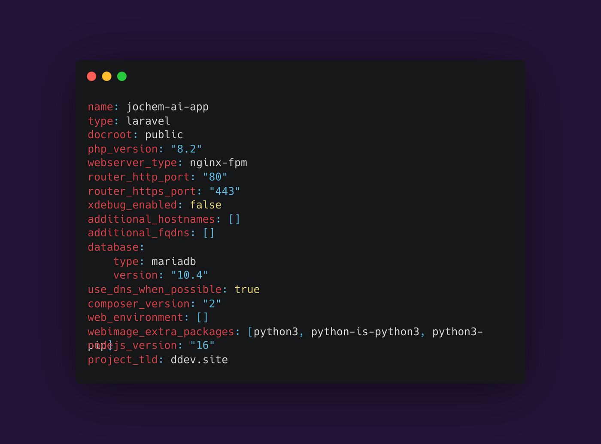

<p class="caption">A pretty useless screenshot of our DDEV config file</p>

Development in our team started out pretty simple; in the Laravel ecosystem, lots of great tools were and are available to get you started real quick. But when the demands got more complex, we needed to reconsider our local environments. With our current setup, we have local setups near-identical to our production infrastructures. In this lengthy post, I’ll walk through all the parts of it.

## Docker using DDEV

At the core of local development lie a few core concepts that need to be set up: the web server, a database, and ideally some routing so we don’t have to use [https://localhost](https://localhost/) but can use realistic domains and subdomains. A Docker setup composing these core elements gives us everything we need, but it can be quite some work to set this up and maintain the setup, especially when you’d like to run multiple projects simultaneously. DDEV is a command line based tool that scaffolds Docker environments for PHP projects. At its core, it initialises a configuration file in your project in which we can enter all kinds of preferences; what version of PHP we want to use, what database type we like to connect to, we can set up subdomains, etc. DDEV comes with PHPMyAdmin and even MailHog pre-shipped. The DDEV CLI tool sets up this config file for you, and on the first start of the environment, docker images and containers are automatically pulled and started.

## Setting up DDEV for your project

First, you need to make sure you have Docker and DDEV installed. DDEV has an excellent explanation how to set this up: [https://ddev.readthedocs.io/en/latest/](https://ddev.readthedocs.io/en/latest/). After making sure all relevant tools are installed, we can set up DDEV in our project.

In the root of your Laravel project, run the following command:

```bash
ddev config
```

This will set up the DDEV environment and generate the config file. You will be asked some questions about your project, but DDEV will probably give you the correct default choice based on your project. DDEV will make use of default passwords and on first startup, will check whether a .env is present. If it is not, great news! A .env file will automatically be generated for you based on the .env.example, with the correct passwords inserted. Lets try this:

```bash
ddev start
```

After the command has finished running, DDEV should report its URLs and you should be able to test by visiting _http://[your-project-name].ddev.site_.

By running `ddev describe`, a list of services running is printed to the Terminal. You should see the obvious building blocks, but also stuff like Mailhog comes in pre-packaged, allowing you to catch and view mail sent from your Laravel app. Check out the DDEV docs, as you can easily add tools to your DDEV environment. For example, adding PHPMyAdmin is as easy as running:

```bash
ddev get ddev/ddev-phpmyadmin
```

But also quickly connecting to the DB via native tools like _TablePlus_ or _Sequelize_ can be done through commands. Or even quickly running some artisan command:

```bash
ddev tableplus
# or
ddev sequelize
# or
ddev artisan [command]
```

If you’d like to expose your DDEV environment to the outside world, e.g. when developing webhooks or connecting otherwise to external services, DDEV comes pre-packed with an _ngrok_ equipped command. Simply run the following and you’ll be given a temporary public URL that can be used anywhere in the world:

```bash
ddev share
```

## Setting up Vite

Modern Laravel apps often require front-end tooling and nowadays, Laravel comes pre-packed with Vite. Vite basically runs a server that bundles CSS and JS and serves them, along neat features like Hot Module Reloading (HMR). Your DDEV environment should however be able to reach this Vite server when it’s running, and you might want to have control over e.g. the NPM version you are using. That’s why we choose to run Vite inside DDEV!

This however, takes a few steps. We’ll walk through them.

### Step 1: altering the Vite config

When using Vite, you’ll have a config file probably in your Laravel root, called `vite.config.ts`. It exports a config with main parts like plugins, resolves and server details. We need to change mainly the `server` bit. Here is our setup:

```ts
server: {
  host: '0.0.0.0',
  port: 5179,
  strictPort: true,
  https: false,
  hmr: {
    protocol: 'wss',
    host: '[app-name].ddev.site', // Update this with your app name
    clientPort: 5179,
  },
},
```

### Step 2: configure Docker

Next, we also need to expose the 5179 port Vite will be served on. We can do this by adding an additional Docker compose file that specifies this. Remember that DDEV orchestrates a set of Docker images; we can easily tweak this setup by adding docker-compose.[service].yaml files.

Create a file called `docker-compose.vite.yaml` in the `.ddev` folder, and enter the following content:

```yaml
version: '3.6'
services:
  web:
    expose:
      - '5179'
    environment:
      - HTTP_EXPOSE=${DDEV_ROUTER_HTTP_PORT}:80,${DDEV_MAILHOG_PORT}:8025,5180:5179
      - HTTPS_EXPOSE=${DDEV_ROUTER_HTTPS_PORT}:80,${DDEV_MAILHOG_HTTPS_PORT}:8025,5179:5179
```

This overwrites what ports are allowed to be exposed by the DDEV Web service (containing the Nginx server a.o.) and secondly we expose the port in the Docker setup.

### Step 3: update the .env file

We typically use React and deploy via Vapor. Therefore, we need to tell vite to use the APP_URL to get assets. By adding the following line to your .env file, assets are loaded properly.

```bash
VITE_VAPOR_ASSET_URL="${APP_URL}"
```

### Step 4: NPM install and run Vite

We can now conveniently use the pre-installed NPM in our Web service, install and run the Vite server:

```bash
ddev npm i
ddev npm run dev
```

This will start up the Vite server and our Laravel application will be able to reach it!

This concludes the how-to for now. I’ll be explanding this article with some other explainers, e.g. how to add additional services as Redis and even S3 compatible file storage, but this basics should get you started for most of the Laravel projects. If you have questions, feel free of course to drop them below!

---

First published on [Medium](https://medium.com/@bartverhaeghnl/local-laravel-development-without-boundaries-using-ddev-82eff0872463).
