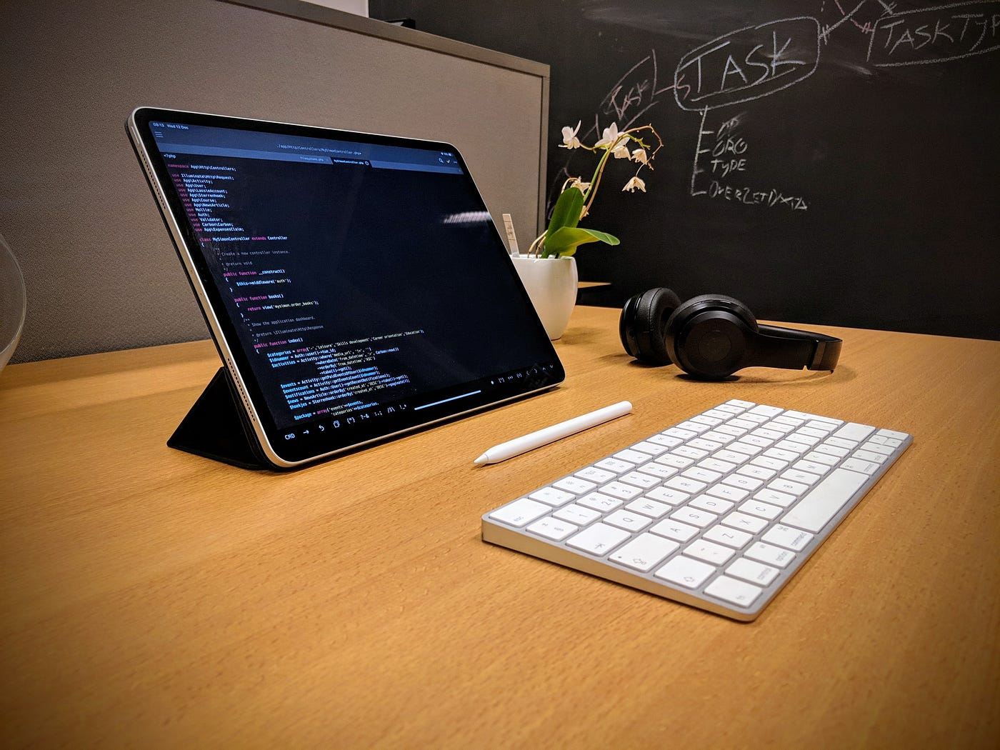
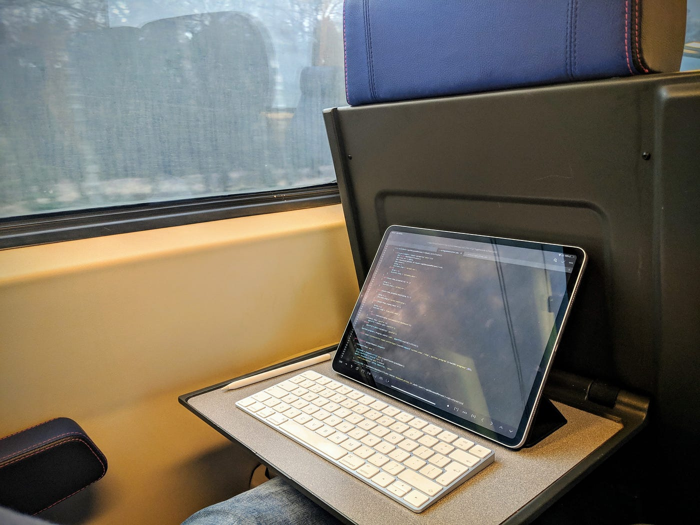

My 15” Macbook Pro’s screen died after only one and a half year of faithful service and it rendered me not only sad but I also had to get a solution right away. A visit to the Apple Store in Amsterdam learned me that taking in the notebook for repair would not only take time this time of the year, but also would set me back about €800,-. The thing I didn’t dare to do, I now did in a brief impulse; I walked out the Store carrying the 12.9” iPad Pro 2018, accompanied with an Apple Pencil 2 and the Smart (non-keyboard) Folio.

## My stack & the search for apps

As I am a Laravel developer, I use the traditional stack of a webserver (Nginx/Apache) and a MySQL database. Although Mac is very well suited for local development using e.g. Laravel Valet, my preference is working on a development VPS running Ubuntu. This VPS is managed by Runcloud.io; they do a great job at removing the hassle of server management. I do version control through git on BitBucket and fortunately Runcloud supports the use of webhooks to automatically update respective apps that are checked out to a specific branch. I haven’t done much research into what bug reporting SaaS platform would fit best for my needs, but at the moment all my apps report to Bugsnag. Finally, mails are handled both inbound and outbound via Mailgun for production, and Mailtrap in the development environment.

No headache yet so far: managing the server, version repository, bug tracking etc. is mostly done through the web browser. It’s the things we devs use most that really require apps; the code editor and the terminal. On Mac, my favorite pick has been PHPStorm and iTerm2, both in constant connection with my development server over SSH. PHPStorm supports full syntax highlighting of Blade templates, allows jumping to definitions, auto-finishes route and view names. It really made me more productive and less prone to coding errors. If Jetbrain would launch a code editor for iOS, I wouldn’t hesitate a moment. Though code editors increasingly pop up in Apple’s App Store, finding the perfect match seemed impossible. Do note that its the screen we look at and type in for a major part of our time. I tried out almost all code editors available; Coda, GoCoEdit, Textastic, Buffer. I’ve sticked with GoCoEdit, as it felt the most productive to me; a very solid remote file browser, quick file search on the remote location, snippets, decent syntax highlighting. (no Blade template syntax highlighting unfortunately) Furthermore, it boasts a decent amount of hotkeys and commands and the app developer is quite active in communicating they’re working on expanding the feature set. I don’t really _miss_ PHPStorm, but I look forward to the day all great things Jetbrains has done also arrive in an iOS editor.

As a replacement for iTerm2 I could’ve used the built in (mini-)shell in GoCoEdit, but I’ve fallen in love with iOS app _Blink_. The SSH client has numerous themes and other customization options, has a very clean interface supporting both typed commands and touch gestures and stores RSA keys to securely connect to my servers instead of only using password authorization. Blink even authorizes the use of the RSA key through Face ID. I think Blink is a serious competitor for iTerm2, be it that they exist on different platforms.

## The Feel

For me, the ‘adventure’ has just started; my new workflow feels much more productive and taking out the slab of glass is a joy time and time again. The iPad Pro feels like the sweet spot between portability and comfort in day to day productive work. Using the Magic Keyboard allows me to take a comfortable position at a desk, in a coffeeshop or in a cramped seat in the train. Much better than a keyboard sticked to the tablet.

How much I like this setup, how much I hate that I can’t resist taking the partially defective Macbook Pro with me every single day. To university, to work. Everywhere I carry two devices. Because I encounter a library I need to get into MATLAB Cloud. Or for when I need to add a rule to GMail, which I can’t do through the browser of Outlook app. Or if someone sends me a _rar archive_.

I don’t give up that easy. The next move for me is putting the MacOS and Windows environments in the cloud instead of in my bag. In my view, the device I carry with me should be the interface to all the tools I need, not neccesarily have them at my local disposal. If a remote desktop or VNC solution can give me the productivity and comfort as if the device were in front of me, I truly feel that this is the future in a 12.9” form factor.

---

First published on [Medium](https://medium.com/@bartverhaeghnl/the-giant-leap-switching-to-ipad-pro-as-a-web-dev-613af11a2d3c).
